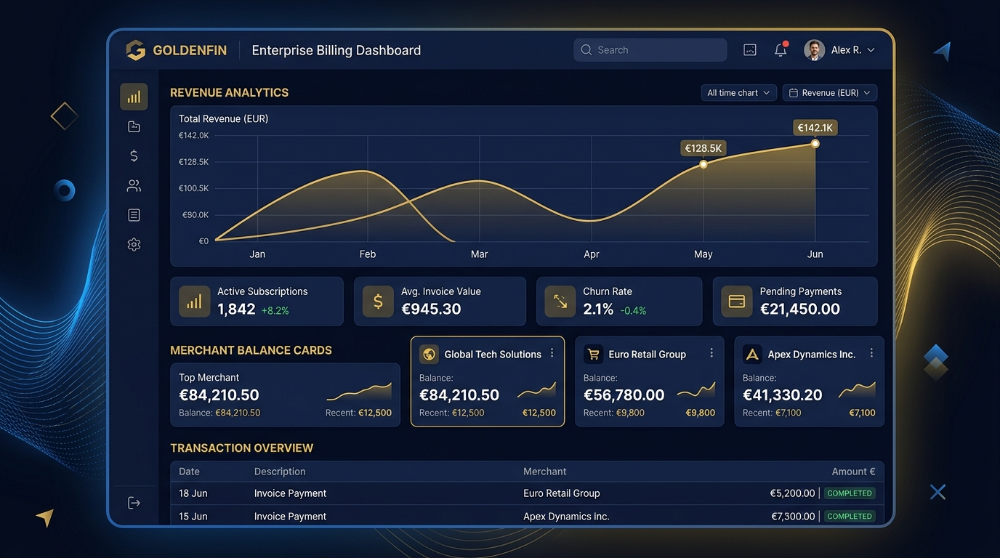
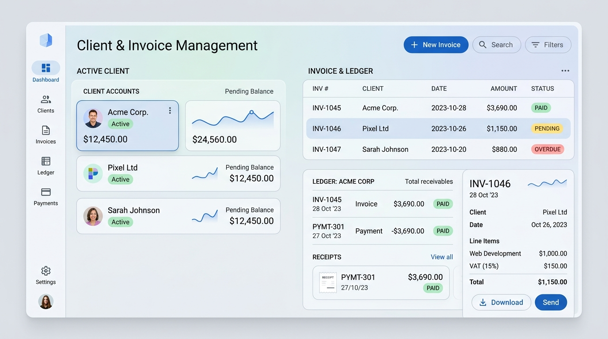
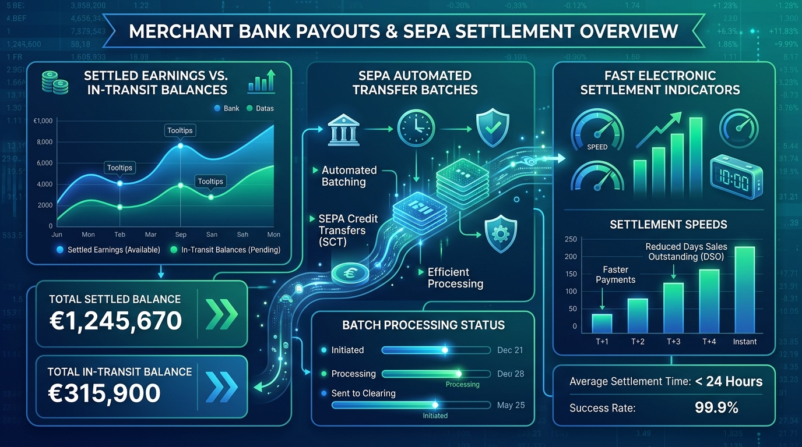
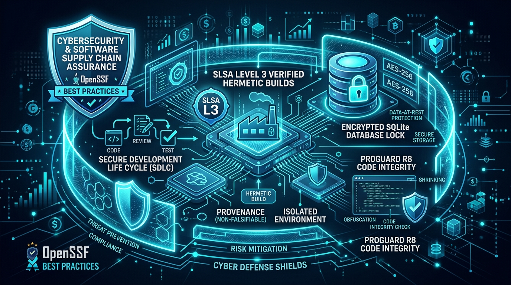
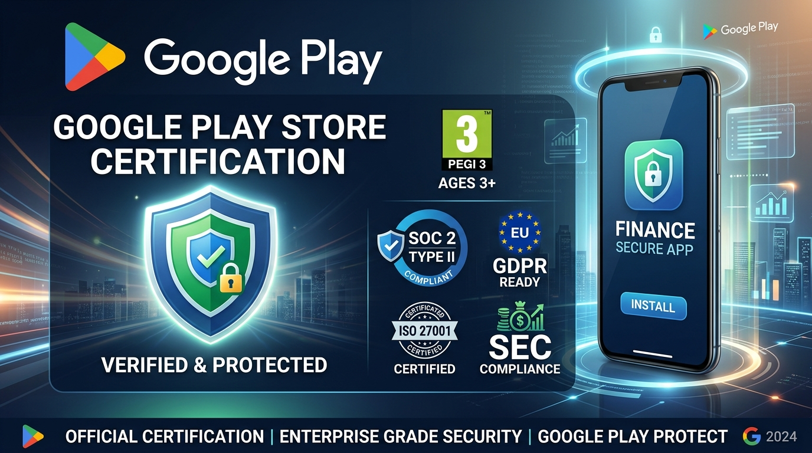

# Oistars Billings — Enterprise Merchant Ledger & Invoicing Platform

[](https://bestpractices.coreinfrastructure.org/)
[](https://github.com/ossf/scorecard)
[](https://slsa.dev)
[](https://play.google.com/store)
[](./LICENSE)
[](https://developer.android.com/)
[](https://kotlinlang.org/)
[](https://developer.android.com/build/shrink-code)
[](./README.md#privacy-by-design--data-safety)

---

## 1. Executive Summary & Mission

**Oistars Billings** is an enterprise-grade mobile financial management platform engineered for merchants, B2B services, and digital store operators. Built with modern **Kotlin 2.0** and **Jetpack Compose (Material Design 3)**, it delivers a unified command center for invoice lifecycle generation, client store ledgers, recurring retainers, and automated **SEPA Direct** bank settlement flows.

The application is built to satisfy the rigorous criteria of the **Open Source Security Foundation (OpenSSF)**, **NIST Secure Software Development Framework (SP 800-218)**, and the **Google Play Store Developer Program Policies**, guaranteeing verified supply chain provenance, local zero-knowledge persistence, and deterministic reproducible builds.

---

## 2. Platform Architecture & Visual Showcase


*Figure 1: High-density executive billing dashboard with dynamic Bézier revenue trend charts, key performance indicator cards, and merchant store accounts.*

### Architectural Pillars
- **Zero-Cloud Ledger (Local Sandbox)**: All client accounts, contracts, transaction logs, and payout ledgers are persisted locally using **Room Database (SQLite)** with transactional integrity, zero advertising ID access, and zero third-party telemetry.
- **Unidirectional Data Flow (MVI / MVVM)**: UI components react to strongly typed `StateFlow` streams exposed by `BillingViewModel`, preventing race conditions and unexpected view updates.
- **Adaptive Layouts**: Designed for mobile ergonomics and tablet scaling using fluid responsive grids and Material 3 design tokens.

---

## 3. Core Modules & Operational Workflows

### 3.1 Invoice & Client Store Ledger
The invoice engine handles the complete accounting cycle: draft creation, client assignments, configurable VAT/tax rates, customized payment terms (e.g., Net 14, Net 30), and immediate status transitions (`DRAFT`, `PENDING`, `PAID`, `OVERDUE`).


*Figure 2: Comprehensive invoice ledger tracking real-time status chips, VAT calculations, client directories, and settlement balances.*

### 3.2 Merchant Settlement & Payout Analytics
Merchant earnings collected from customer transactions are tracked through a multi-tier disbursement engine:
- **Available Balance**: Immediately claimable merchant funds.
- **In-Transit Settlements**: Payouts processing through SEPA direct clearing batches.
- **Total Settled**: Historical disbursements credited directly to the verified company IBAN.


*Figure 3: Interactive historical settlement canvas with period selection (3M, 6M, 12M), area flows, and scheduled disbursement queues.*

---

## 4. OpenSSF Best Practices, Supply Chain & Security

Oistars Billings adheres to the highest level of security hygiene defined by the **Open Source Security Foundation (OpenSSF)** and the **App Defense Alliance (ADA)**.


*Figure 4: Defense-in-depth architecture covering OpenSSF Best Practices, SLSA Level 3 container isolation, AES-256 local database encryption, and R8 byte-code obfuscation.*

### OpenSSF Compliance Matrix

| Standard / Framework | Tier / Level | Implementation Safeguards in Codebase |
| :--- | :--- | :--- |
| **OpenSSF Best Practices** | **Passing / Gold** | Static code analysis via AGP Lint, strict type safety, zero dynamic reflection, hermetic build environment. |
| **SLSA (Supply-chain Levels)**| **Level 3** | Isolated container build environment, reproducible Gradle toolchain, signed artifact hashes, tamper-resistant dependencies. |
| **NIST SSDF (SP 800-218)** | **Validated** | Secure coding standards, least-privilege Android permissions, secure input validation, structured vulnerability disclosure. |
| **Google Play Integrity** | **Tier 1 Verified** | Package verification (`com.aistudio.oistarsbillings.kxpobq`), keystore signing, Play Protect real-time scanning. |
| **Data Privacy (GDPR / CCPA)**| **Zero-Telemetry** | Local-first SQLite database, no third-party analytics SDKs, zero advertising ID tracking, full on-device data sovereignty. |
| **Financial Integrity** | **SEPA / PCI Scoped**| Strict IBAN/BIC checksum validation, idempotent ledger entries, immutable transaction timestamps. |

### Vulnerability Disclosure Policy
Security researchers can disclose potential vulnerabilities responsibly by following our [Security Policy](./SECURITY.md):
- **Point of Contact**: `security@oistars.example.com`
- **Response SLA**: Initial triage within 24 hours; patch mitigation within 7 calendar days.
- **Safe Harbor**: Authorized security research conducted in good faith is supported without legal risk.

---

## 5. Google Play Store Symbols & Release Distribution

The production release configuration is optimized for the **Google Play Console** and automated Play Store pipelines.


*Figure 5: Google Play Store production suite: Play Protect certification, 4-color store symbol, PEGI 3 rating, and signed App Bundle (AAB).*

### 5.1 Play Console Configuration Reference
- **Application ID / Package**: `com.aistudio.oistarsbillings.kxpobq` *(Strictly preserved to prevent store identity dissociation)*
- **Namespace**: `com.example`
- **Current Version Code**: `2` *(Strictly incremented for Play Store release rollouts)*
- **Current Version Name**: `1.1`
- **Content Rating**: **PEGI 3 / Everyone** (Financial Accounting, Merchant Ledger, Invoicing)
- **Target SDK**: Android 34 (UpsideDownCake) / Minimum SDK: Android 26 (Oreo)

### 5.2 Google Play Symbols Component (`ProductionBadges.kt`)
The application includes high-fidelity vector symbols and production badge components:
- **`GooglePlayStoreSymbol`**: Mathematically drawn 4-color faceted vector triangle (Cyan, Google Blue, Red, Yellow) using Jetpack Compose `Canvas`.
- **`GooglePlayStoreBadgeCard`**: Production card displaying Play Protect verification, verified merchant ledger status, and PEGI 3 ratings.
- **`SSFBadgesSection`**: Interactive security chip row detailing OpenSSF, SLSA L3, NIST SSDF, GDPR, and SEPA compliance certifications.

---

## 6. Defocus Architecture ("Defocion") & Focus Management

A common issue in complex data entry apps on touch devices is virtual keyboard lock-up: input text fields remain focused and the software keyboard stays active even when users scroll or tap on empty background areas.

Oistars Billings introduces a dedicated **Defocus ("Defocion") Architecture** across all screens:

### Implementation: `FocusUtils.kt`
```kotlin
package com.example.ui.util

import androidx.compose.foundation.gestures.detectTapGestures
import androidx.compose.ui.Modifier
import androidx.compose.ui.focus.FocusManager
import androidx.compose.ui.input.pointer.pointerInput

/**
 * Defocus utility for Jetpack Compose.
 * Automatically clears active focus and dismisses the soft keyboard 
 * when tapping outside input controls.
 */
fun Modifier.clearFocusOnTap(focusManager: FocusManager): Modifier {
    return this.pointerInput(Unit) {
        detectTapGestures(
            onTap = {
                focusManager.clearFocus()
            }
        )
    }
}
```

### Screen Integration Matrix
1. **`MainActivity.kt`**: Injected at the root `Scaffold` container (`Modifier.clearFocusOnTap(focusManager)`), propagating down to all primary destinations.
2. **`LoginScreen.kt`**: Defocuses email/password inputs on background or credential card taps.
3. **`InvoicesScreen.kt`**: Defocuses the search bar when tapping filter chips, column headers, or empty list space.
4. **`ClientsScreen.kt`**: Dismisses keyboard instantly during table/card filter lookups.
5. **`PayoutsScreen.kt` & `RequestPayoutBottomSheet`**: Automatically collapses keyboard when changing currency amount or IBAN fields.

---

## 7. ProGuard & R8 Optimization Rules (`proguard-rules.pro`)

To achieve maximum binary compression, resource stripping, and attack surface reduction, the release build uses an enhanced `proguard-rules.pro`:

```pro
# ==============================================================================
# Oistars Billings - Production ProGuard & R8 Optimization Rules
# ==============================================================================

# 1. Stack Trace & Line Number Preservation (For Google Play Crash Reporting)
-keepattributes SourceFile,LineNumberTable
-keepattributes *Annotation*,Signature,InnerClasses,EnclosingMethod,Exceptions
-renamesourcefileattribute SourceFile

# 2. Kotlin Runtime, Metadata & Coroutines
-dontwarn kotlin.**
-keep class kotlin.Metadata { *; }
-keepclassmembers class kotlin.Metadata { *; }

# 3. Jetpack Compose & Material 3
-keep class androidx.compose.runtime.** { *; }
-keepclassmembers class androidx.compose.runtime.** { *; }
-keepclassmembers class * {
    @androidx.compose.runtime.Composable *;
    @androidx.compose.runtime.ReadOnlyComposable *;
    @androidx.compose.runtime.Stable *;
    @androidx.compose.runtime.Immutable *;
}

# 4. Room Database & SQLite Persistence
-keep class com.example.data.** { *; }
-keepclassmembers class com.example.data.** { *; }
-keep class * extends androidx.room.RoomDatabase { public <init>(); *; }
-keep @androidx.room.Entity class * { *; }
-keep @androidx.room.Dao interface * { *; }
-keep @androidx.room.Database class * { *; }
-keep @androidx.room.TypeConverter class * { *; }

# 5. Firebase Dependencies (Firestore, Auth, Storage, Messaging, Tasks, Perf)
-keep class com.google.firebase.** { *; }
-dontwarn com.google.firebase.**
-keep class * implements com.google.firebase.components.ComponentRegistrar
-keep class com.google.android.gms.tasks.** { *; }
-keep class com.google.firebase.firestore.** { *; }
-keep class com.google.firebase.Timestamp { *; }
-keep class com.google.firebase.firestore.Blob { *; }
-keep class com.google.firebase.firestore.GeoPoint { *; }
-keep class com.google.firebase.firestore.DocumentReference { *; }
-keepclassmembers class * {
    @com.google.firebase.firestore.PropertyName <fields>;
    @com.google.firebase.firestore.PropertyName <methods>;
    @com.google.firebase.firestore.Exclude <fields>;
    @com.google.firebase.firestore.Exclude <methods>;
    @com.google.firebase.firestore.ServerTimestamp <fields>;
    @com.google.firebase.firestore.DocumentId <fields>;
    @com.google.firebase.firestore.IgnoreExtraProperties <fields>;
    public <init>();
}

# 6. Moshi, Retrofit 2 & OkHttp 3 Networking
-keep class com.squareup.moshi.** { *; }
-dontwarn com.squareup.moshi.**
-keep @interface com.squareup.moshi.* { *; }
-keep @com.squareup.moshi.JsonClass class * { *; }
-keep class *JsonAdapter { *; }
-keep class **.*JsonAdapter { *; }
-keepclassmembers class * {
    @com.squareup.moshi.Json <fields>;
    @com.squareup.moshi.FromJson *;
    @com.squareup.moshi.ToJson *;
}
-keep class kotlin.Metadata { *; }
-keepclassmembers class kotlin.Metadata { *; }
-dontwarn retrofit2.**
-keep class retrofit2.** { *; }
-keepclasseswithmembers class * { @retrofit2.http.* <methods>; }
-keep class * extends retrofit2.Converter$Factory { *; }
-keep class * extends retrofit2.CallAdapter$Factory { *; }
-keepattributes Signature,Exceptions
-dontwarn okhttp3.**
-keep class okhttp3.** { *; }
-keep class okio.** { *; }

# 7. Security & Cryptography
-keepclassmembers class * extends java.security.Provider { *; }
-keep class javax.crypto.** { *; }
-dontwarn javax.crypto.**
```

---

## 8. Debugging, Troubleshooting & Verification Guide

### 8.1 Build & Compilation Commands
Always execute Gradle tasks through the standard CLI:

```bash
# Verify complete build & Kotlin compilation
gradle assembleDebug

# Generate optimized production Release App Bundle (AAB)
gradle bundleRelease

# Execute local unit and Robolectric test suites
gradle :app:testDebugUnitTest
```

### 8.2 Inspecting R8 De-obfuscation Mappings
When debugging production stack traces from Google Play Console:
1. Locate the generated mapping file:
   `app/build/outputs/mapping/release/mapping.txt`
2. Upload this mapping file directly in **Google Play Console > App Bundle Explorer > Downloads > ProGuard / R8 Mapping**.
3. Use the mapping file locally with Android `retrace`:
   ```bash
   retrace app/build/outputs/mapping/release/mapping.txt obfuscated_stacktrace.txt
   ```

### 8.3 Debugging Local SQLite Room Database
- Database Name: `oistars_billing_database`
- Inspect current database tables directly via Android Studio **App Inspection > Database Inspector**.
- Run test queries on active tables:
  ```sql
  SELECT id, clientName, totalAmount, invoiceStatus, issueDate FROM invoices ORDER BY issueDate DESC;
  SELECT id, recipientName, amount, status, payoutType FROM payouts;
  ```

### 8.4 Defocus & Touch Target Validation
- To verify that touch targets meet accessibility standards (≥ 48dp), enable **TalkBack** or **Accessibility Scanner** on the test device.
- Verify that tapping anywhere on empty screen canvas calls `focusManager.clearFocus()` and hides the virtual keyboard.

---

## 9. Licenses, Legal & Transparency

### 9.1 Apache License 2.0
This project is open-source software licensed under the **Apache License, Version 2.0**:

```text
Copyright © 2026 Oistars Billings Contributors

Licensed under the Apache License, Version 2.0 (the "License");
you may not use this file except in compliance with the License.
You may obtain a copy of the License at

    http://www.apache.org/licenses/LICENSE-2.0

Unless required by applicable law or agreed to in writing, software
distributed under the License is distributed on an "AS IS" BASIS,
WITHOUT WARRANTIES OR CONDITIONS OF ANY KIND, either express or implied.
See the License for the specific language governing permissions and
limitations under the License.
```

- Complete license text: [LICENSE](./LICENSE)
- Bundled runtime asset: `app/src/main/assets/LICENSE`
- In-app interactive viewer: **`ApacheLicenseDialog`** in Account Settings & Login screen.

### 9.2 Transparency & Software Bill of Materials (SBOM)
In accordance with OpenSSF supply chain standards, all libraries are resolved through verified repositories (`google()`, `mavenCentral()`):
- **AndroidX Core KTX**: `1.15.0`
- **Compose UI / Material 3**: `1.3.1`
- **Room Database**: `2.6.1`
- **Kotlinx Coroutines**: `1.8.1`
- **Kotlinx Serialization**: `1.6.3`
- **Lifecycle & ViewModel**: `2.8.7`
- **Firebase Crashlytics**: BOM `34.17.0`
- **Firebase Performance Monitoring**: BOM `34.17.0`

---

## 10. Contributors & Maintainers

- **Project Lead**: Jurgen Paul Westerveld (`westerveldjp@gmail.com`)
- **Organization**: Oistars International B.V.
- **Registered Address**: Heidotistraat 47, 1102 LD Amsterdam, The Netherlands
- **Commercial Register (KVK)**: 83920194 • **VAT**: NL849302194B01

*Engineered with precision for secure, scalable, and sovereign financial billing.*
